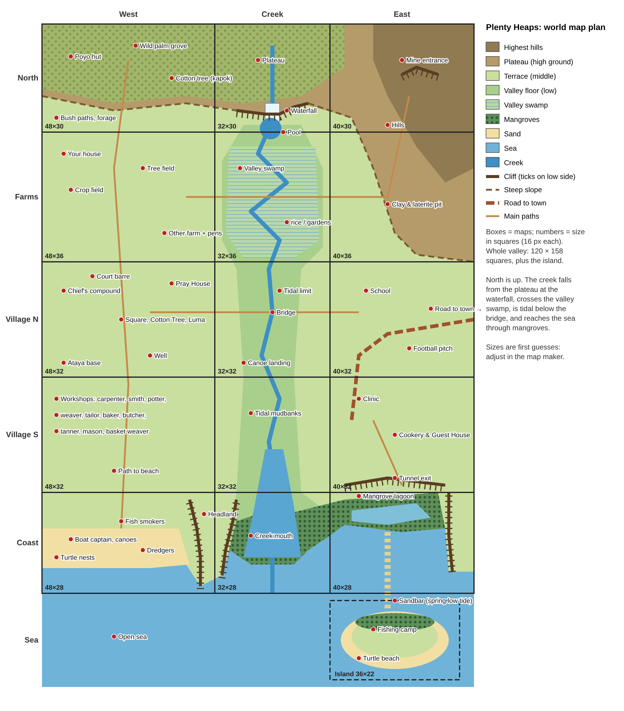

# Plenty Heaps — Design Document

The record of what has been decided, and what is still open. Read this at the
start of any work session; update it whenever a decision changes.

*Last updated: 11 November 2026 (four seasons of 12 days; crop calendar; rain, daylight, moon, tides and sky, for Lungi; foraging; fishing; year at a glance; world map plan; built the time systems and the map maker's tile list)*

---

## 1. The game in one paragraph

**Plenty Heaps** is a 16-bit-style farming and life game, in the spirit of
Harvest Moon, set in a coastal West African village. The player farms, sells
their harvest, and gets to know the villagers; later they will also fish,
tend trees and animals, and explore. It is built for learners using
**Kolibri** (offline learning platform) and any LMS that accepts HTML5 or
**SCORM 1.2** packages.

**The name** comes from *heaps*, the raised mounds of tilled earth that crops
are planted in (as taught in "Agric" at school), and from *plenty*. In the
game, the hoe turns ground into heaps. Krio wouldn't add the plural *s*, but
the name mixes Krio and English anyway, and "Plenty Heaps" reads better.

## 2. Setting and culture

- **Inspired by coastal Sierra Leone**, without naming it. It should also
  feel familiar to learners in **Guinea** and **Liberia**.
- **Four seasons**, following the region's real year: **First Rain** (early
  rains, around May–July), **Big Rain** (around August–October; also known as
  the **Hungry Season**, the lean months before the harvest), **Harmattan**
  (early dry season, around November–January) and **Warm Season** (late dry
  season, around February–April). The game starts on First Rain 1. Use "Big
  Rain" as the season's name in the game; "Hungry Season" can appear in
  dialogue and lessons. Krio and other local names for the seasons are to come
  from the language review.
- **Position and clock:** the sky, daylight and tides are worked out for
  **Lungi, Sierra Leone (8.6°N, 13.2°W)**, with clocks on **GMT** (as in
  Sierra Leone, Guinea and Liberia), so midday is near 12:53.
- **Village:** round mud-walled houses with patterned walls and thatched
  roofs, a red laterite earth square, a market stall, palms, and the sea.
- **Language:** English text with light Krio ("Kushe", "Tenki", "How di
  bodi?"). **All Krio must be checked by a native speaker.** French is planned
  for Guinea. Local languages (Krio, Temne, Mende, Susu...) need a pixel font
  with letters like ɛ, ɔ and ŋ.
- **Cultural review:** names, dialogue, clothing, food and buildings should be
  reviewed by people from the region before release.
- **Sensitive topics:**
  - **Mining:** artisanal gold mining is tied to child labour and mercury, so
    use clay, laterite, salt or fantasy caves instead.
  - **Wildlife:** endangered animals (pygmy hippo, chimpanzees, sea turtles,
    manatees) are to be observed or protected, never hunted. No bushmeat
    hunting mechanic.
  - **Pigs:** left out, given the mixed Muslim and Christian population.

## 3. Platforms and technical decisions

| Decision | Choice | Why |
|---|---|---|
| Engine | **Phaser 3.90.0** (final v3, pinned) | Mature, first-class Canvas fallback for old phones |
| Code style | Plain `<script>` files, one global `FarmSim`, **ES2015 only** | No build step; runs on old Android WebViews |
| Screen | 640×360 canvas; world camera zoomed 2× (320×180 world) | Pixel-art look with readable text |
| Tiles | 16×16 | Matches the art packs and Tiled |
| Characters | **16×32** (3 frames × 4 directions) | From the Petixel art packs |
| Maps | Tiled-format `.tmj` files, made with the game's own map maker → one generated script | Easy linking of maps and rooms; still opens in Tiled; no network loading |
| Kit | **EduGame Kit**, as a **Saved Game** (no scores) | Same zip for Kolibri, SCORM LMSs, RACHEL, Kiwix; GitHub builds it |
| Saving | Through the kit's helper (`edugame.js`): SCORM `suspend_data`, Kolibri Games, or the browser | The helper picks the platform; the game never touches SCORM itself |
| Package | `edugame build`: one zip for every platform | Built and checked by GitHub Actions |
| Kit header / Options | **Off** (`"header": false`) | Settings will live in an in-game menu (see Open decisions) |

**Target devices:** Dell Chromebook 3100 (ChromeOS or Xubuntu), older and
budget Android phones (e.g. Tecno), through Kolibri's app or browser. The
game has been checked with both the WebGL and the Canvas renderer.

## 4. Saving

- **Format:** bit-packed, base64url, 16-bit checksum. Currently **version 3**
  (the area takes 6 bits: up to 64 maps, each with a permanent id in its map
  file; versions 1 and 2 still load).
- **Size:** worst case **502 of 4096 characters (12%)**; a new game is about
  90. Even 64 villagers, 255 flags, 31 slots, 15 currencies and 255 outfits
  fit in about 800.
- **Golden rule:** saves store **IDs, never names**. Never change or reuse an
  `id` in items, crops, villagers, flags, areas, currencies or appearance
  options after release.
- **Not saved:** anything that can be recalculated (weather, critters,
  map contents).
- **When:** after sleeping, on changing area, every 5 seconds of play (when
  anything changed), and when the page is hidden or closed. Kolibri only keeps
  what reached it before the learner leaves the resource (it stops listening
  before the game's page closes), so the game can't rely on a last save.
- **Never lose a farm:** each save is read back before it's written. A save that
  can't be loaded (damaged, or from a newer version) is never saved over: the
  learner chooses to play without saving or (if damaged) to start a new farm.
- **Old saves always load:** version 1 saves (from the first slice) are
  upgraded automatically, and a test proves it.
- The kit keeps the game's save string inside its own record:
  `{"_v": 1, "_save": "<the string>"}`. It allows 3,900 characters for it.
- **Completion:** when the `firstShipment` flag is set, the game calls
  `EduGame.complete()`, which sets SCORM status `passed` (Kolibri ignores
  `completed`). This is a placeholder until learning goals are agreed.
- The kit doesn't set SCORM `cmi.core.exit` to `suspend` (Kolibri doesn't
  need it; some other learning systems start a fresh attempt without it).
  To raise with the kit.

## 5. Gameplay (current)

- **Day:** 06:00 to 24:00, about 12.5 real minutes. Passing out at midnight
  costs half your energy the next morning.
    - **Change:** Probably change to 24 hours with 8 hours of sleep. 1 minute is 1 hour of game time.
    - HM:AWL has full 24 hour days with 1 minute = 1 hour (24 minute days), minus sleeping time (6 hours)
    - HM:FoMT has 24 hour days with 1 minute = 2 hour (12 minute days), minus sleeping time
- **Week:** 4 Day Weeks
- **Seasons (decided):** 4 seasons of **12 days**, a 48-day year:
  First Rain → Big Rain → Harmattan → Warm Season. With 16-minute days that's
  12.8 hours of play per year.
  - HM:AWL has 10 day seasons. With 18 minute days and 4 seasons per year, that's 12 hours per year.
  - HM:FoMT has 30 day seasons. With 18 minute days and 4 seasons per year, that's 18 hours per year.
  - **Built** (`src/core/calendar.js`, `src/config.js`). The season and
    weather are worked out from the day number, so changing the season length
    after release would move existing farms into another season.
- **Rain (built: `src/core/weather.js`).** Rain isn't just on or off for a day: each day's rain
  has a start time and a length, worked out from the world seed and the day
  (never saved, so a forecast is possible). Proposed numbers:

  | Season | Chance of rain on a day | How long it rains | Waters crops? |
  |---|---|---|---|
  | First Rain | 60% | Mostly 1–4 hour storms in the afternoon or evening; sometimes all day | Often |
  | Big Rain | 85% | 3 hours to all day; about 4 in 10 rainy days rain all day | Almost always |
  | Harmattan | 3% | 1–2 hours of light rain | No: water by hand |
  | Warm Season | 12% | 1–3 hour storms in the late afternoon, as the rains come back | Sometimes |

  - **Watering rule:** a day's rain waters the crops once it adds up to **4
    hours**. Storms are heavy rain and count double, so a 2-hour storm waters
    too. From that moment, all tilled soil counts as watered for the day.
    A short shower doesn't, so players learn that a little rain isn't enough.
  - Several shorter spells on one day add up. Rain stops by midnight; if days
    become 24 hours, rain while the player sleeps counts for the day it falls.
  - Big Rain days that rain all day could flood paths (see Events).
- **Daylight (built: `src/core/sky.js`; the screen darkens from dusk to first
  light).** Worked out for **Lungi, Sierra Leone (8.6°N,
  13.2°W)**, to the minute, in **GMT clock time** as used in the region.
  Because the region is west of Greenwich, midday comes at about **12:53**
  on average; it wanders between **12:37** (Harmattan 1) and **13:07** (Warm
  Season 2) over the year (the "equation of time", from the earth's tilt and
  oval orbit). Twilight is real civil twilight, about 21–23 minutes.

  | Day | First light | Sunrise | Midday | Sunset | Dark | Daylight |
  |---|---|---|---|---|---|---|
  | First Rain 1 | 06:13 | 06:35 | 12:49 | 19:03 | 19:25 | 12 h 28 min |
  | **First Rain 7** (June solstice, longest day) | 06:12 | 06:35 | 12:54 | 19:13 | 19:36 | **12 h 37 min** |
  | Big Rain 1 | 06:23 | 06:45 | 12:59 | 19:13 | 19:35 | 12 h 28 min |
  | **Big Rain 7** (September equinox) | 06:22 | 06:43 | 12:46 | 18:50 | 19:10 | **12 h 7 min** |
  | Harmattan 1 | 06:22 | 06:43 | 12:37 | 18:30 | 18:51 | 11 h 46 min |
  | **Harmattan 7** (December solstice, shortest day) | 06:39 | 07:02 | 12:50 | 18:39 | 19:02 | **11 h 37 min** |
  | Warm Season 1 | 06:51 | 07:13 | 13:06 | 19:00 | 19:21 | 11 h 46 min |
  | **Warm Season 7** (March equinox) | 06:36 | 06:57 | 13:00 | 19:04 | 19:25 | **12 h 7 min** |

  - **Extremes:** earliest sunrise 06:32 (First Rain 4), latest sunset 19:16
    (First Rain 10), latest sunrise 07:13 (Warm Season 1), earliest sunset
    18:29 (Harmattan 2).
  - **How to work it out** (every day, in code):
    - Sun's declination δ = 23.44° × cos(2π × (day of year − 7) ÷ 48), with
      day of year 1–48 (First Rain 1 = 1).
    - Midday = 12:00 + 52.8 min (13.2° × 4 min) − equation of time. For the
      equation of time, turn the game day into a real day of the year,
      172 + (day of year − 7) × 365.25 ÷ 48, and use the standard formula
      (in minutes, with g = 2π × (real day − 1) ÷ 365):
      229.18 × (0.000075 + 0.001868 cos g − 0.032077 sin g − 0.014615 cos 2g
      − 0.040849 sin 2g).
    - Hour angle for a sun height h: H = acos((sin h − sin 8.6° × sin δ) ÷
      (cos 8.6° × cos δ)), in degrees; 4 minutes per degree.
    - Sunrise and sunset: midday ∓ H(−0.833°) × 4 min (−0.833° allows for
      the sun's size and the air bending its light, so the equinox day is a
      little over 12 hours).
    - First light and dark: midday ∓ H(−6°) × 4 min.
    - Simpler option: drop the equation of time and keep midday at 12:53
      all year (times move by up to 16 minutes).
  - Real effects this keeps, good for a lesson: midday is near 1 pm by the
    clock; the equinox day is 12 h 7 min, not 12; and the latest sunrise
    (Warm Season 1) and earliest sunset (Harmattan 2) don't fall on the
    shortest day.
  - Day length changes by only about an hour over the year; weather,
    harmattan haze and the sun's position (see Sky) do more to make the
    seasons look different.
- **Moon (built: `src/core/sky.js`).** A moon month is **11 days** (264 game hours): close to a
  season, but not the same, so moon and seasons drift apart like the real
  lunar and solar calendars.
  - Moon age = game hours since the start (plus an offset) mod 264. Full moon
    at age 0, new moon at age 132.
  - A **lunar year** is 4 moons = 44 days, 4 days shorter than the 48-day
    solar year. So holidays on the lunar calendar (Fast Week) come **4 days
    earlier each year**, and travel round all the seasons in 12 years, as
    real lunar holidays do over about 33 years.
  - **Where it is in the sky:** the moon falls behind the sun by a full
    circle every moon month, so it rises about **2 h 24 min later each day**
    (a "moon day" of 26 h 24 min). A full moon rises at sunset and is highest
    at midnight; a new moon is next to the sun. Position and phase always
    agree.
- **Tides (built: `src/core/sky.js`, `src/core/mapView.js`).** Two high and two low tides a day, following the moon
  in the sky:
  - **Period:** a high tide every **13 h 12 min** (half a moon day: 12 × 11 ÷
    10 hours). High tide comes about **2 h 24 min later each day**, with the
    moon. High tide is when the moon is highest in the sky or directly
    underfoot (a fixed delay of an hour or two can be added, as on real
    coasts).
  - **Springs and neaps:** **spring tides** (biggest range: highest highs,
    lowest lows) at **full and new moon**, every 5½ days; **neap tides**
    (smallest range) at half moon, in between. As on real coasts.
  - **Repeats every 5½ days:** the tide times depend only on the moon's age,
    so a tide table by moon day ("full or new moon: high tide at ...") works
    for the whole game, the way fishers know their own coast.
  - **Formula:** tide level = range × cos(2π × (t − t₀) ÷ P), where t is game
    hours since First Rain 1 at 00:00, P = 13.2 hours and t₀ is the time of
    a high tide at full moon. range = 1 + 0.4 × cos(2π × moon age ÷ 132)
    − 0.15 × cos(2π × (day of year − 7) ÷ 24): 0.6 at half moon, 1.4 at full
    and new moon, a little more when they fall near an equinox (Big Rain 7,
    Warm Season 7) and a little less near a solstice.
  - **Tide by area:** the tide reaches the mangroves and well up the creek,
    not just the beach. Each map has a tide **delay** (the tide takes time to
    travel inland) and **size** (share of the full range), as map
    properties:

    | Area | Delay | Size | Notes |
    |---|---|---|---|
    | Beach, island | 0 | Full | Open coast |
    | Creek mouth, mangroves | +30 min | Full, or a little more | Mangroves only grow where the tide floods twice a day |
    | Lower creek (bridge) | +1 to 2 h | About half | Water rises and falls at the banks |
    | Valley swamp, upper creek, waterfall | — | Not tidal | |

  - **Salt and fresh water:** in the rains, river water pushes the salt back
    toward the sea; in the dry season salt creeps further up the creek
    (could limit where crops can be watered from the creek).
  - Nothing is saved: the tide comes from the date and time. Low tides uncover
    oysters, crabs and tide pools; the boat launches at high tide. A villager
    or sign can show the tide table.
- **Sky (planned; the sun, moon and tide maths are built).** At least one screen shows the sun and moon (and at night,
  the stars) where they really are. For an astronomy lesson or minigame:
  - **Sun:** rises in the east and sets in the west. At Lungi it passes
    **straight overhead twice a year**, around **Big Rain 4** and **Warm
    Season 10**; between them (late Warm Season to early Big Rain) the noon
    sun is in the **northern** half of the sky, otherwise the southern.
  - **Stars:** the star day is 24 × 48 ÷ 49 hours = **23 h 31 min**, so the
    stars rise **about 30 minutes earlier each night** and the sky turns once
    a year: each season has its own night sky, the same every year. Map the
    real sky onto the game year (the seasons match real months), so Orion is
    up on Harmattan evenings and Scorpius on First Rain and Big Rain
    evenings.
  - **Star band:** 12 star groups along the sun's path; the sun spends 4 days
    (one game week) in each.
  - **The moon's star month** (once round the star groups) is about **9
    days**, shorter than its 11-day phase month, as the real 27.3-day star
    month is shorter than the 29.5-day one.
  - From Lungi almost the whole sky is visible: Polaris about 9° above the
    northern horizon, and the Southern Cross low in the south in some
    seasons.
  - Ask the cultural reviewers about local star names and stories, and about
    stars used to time planting (as the Pleiades are in many West African
    farming traditions).
- **Farming:** the hoe makes heaps, then you plant seeds and water them; rain
  waters everything. A watered day is one day of growth. When the season
  changes, out-of-season crops wither.
- **Crop calendar.** A crop can grow across more than one season; it only
  withers when a season starts that isn't in its list. **Plant by** is the
  last day you can plant it and still harvest before it withers, if it's
  watered every day. Crops that grow in all four seasons never wither. Grow
  times are shortened for play, but keep the real order (greens fast, roots
  and rice slow) and the real planting times.
  - **Crops so far** (seasons updated for the four-season year):

    | Crop | Seasons | Days | Regrows | Plant by | Notes |
    |---|---|---|---|---|---|
    | Maize | First Rain, Big Rain | 5 | No | Big Rain 7 | First crop of the rains |
    | Groundnut | First Rain, Big Rain | 7 | No | Big Rain 5 | |
    | Krain krain | All | 3 | Every 2 days | Any time | Grown year-round in swamp gardens |
    | Pepper | Harmattan, Warm Season | 6 | Every 3 days | Warm Season 6 | Dry-season garden crop |
    | Cassava | All | 12 | No | Any time | Real cassava takes most of a year |

  - **Planned crops** (proposed numbers, to check with Agric teachers):

    | Crop | Seasons | Days | Regrows | Plant by | Notes |
    |---|---|---|---|---|---|
    | Upland rice | First Rain, Big Rain | 14 | No | First Rain 10 | The staple. Must be sown early in the rains |
    | Swamp rice | Big Rain, Harmattan | 12 | No | Big Rain 12 | Swamp only; transplanted in the Big Rain, harvested in the harmattan |
    | Okra | First Rain, Big Rain | 6 | Every 3 days | Big Rain 6 | |
    | Benniseed | First Rain, Big Rain | 8 | No | Big Rain 4 | |
    | Bissap (hibiscus) | Big Rain, Harmattan | 8 | No | Harmattan 4 | Red dye and a sour leaf; upland, unshaded. **Foraged first**, then farmed once the player has seeds (see Foraging) |
    | Cotton | Big Rain, Harmattan | 12 | No | Big Rain 12 | For the weaver |
    | Cocoyam | First Rain, Big Rain, Harmattan | 16 | No | Big Rain 8 | |
    | Yam | Warm Season, First Rain, Big Rain | 20 | No | First Rain 4 | Best planted in the Warm Season, before the rains |
    | Sweet potato | Big Rain, Harmattan | 8 | No | Harmattan 4 | Often follows swamp rice. Leaves could be picked as a second product |
    | Garden eggs | Harmattan, Warm Season | 7 | Every 3 days | Warm Season 5 | |
    | Tomato | Harmattan, Warm Season | 7 | Every 2 days | Warm Season 5 | Too much disease in the rains |
    | Onion | Harmattan, Warm Season | 8 | No | Warm Season 4 | Also a yellow dye |
    | Sugarcane | All | 24 | Every 12 days | Any time | Long-term |

  - **What each season is for:** *First Rain*: rice, maize, groundnut and the
    other rain crops go in. *Big Rain*: weeding, the first harvests,
    swamp rice transplanted. *Harmattan*: rice, cotton and cocoyam harvests,
    dry-season gardens start (watering needed). *Warm Season*: garden crops,
    yams planted, fruit trees bear; clearing ("brushing") land for the next
    rains.
  - Crop ids are 1–30, so there's room for all of these (17 in total).
    Indigo is foraged, not farmed (see Foraging).

- **Selling:** the shipping crate pays out overnight.
- **Shop:** Pa Sorie's seed stall in the village.
- **Villagers:** Aunty Kadi and Pa Sorie. Talking raises friendship once a
  day; holding a crop and talking gives it as a gift.

### Planned crops, trees and animals
- **More crops:** upland and swamp rice (the staple, central to the rainy
  season), okra, sweet potato (leaves too), garden eggs, onions, tomatoes,
  yams, cocoyam, benniseed, sugarcane.
- **Trees** (long-term investments, kept in their own list, not the crop
  list): trees never wither; they bear in their seasons. Proposed seasons, to
  check with Agric teachers:

  | Tree | Bears in | Notes |
  |---|---|---|
  | Oil palm | All (most in Warm Season, First Rain) | Palm oil processing. **Wild groves first**, planted palms later (see Foraging) |
  | Coconut | All | |
  | Banana, plantain | All | |
  | Mango | Warm Season | "Mango season" |
  | Cashew | Warm Season | |
  | Cocoa | Big Rain, Harmattan | Needs shade |
  | Coffee | Harmattan | Needs shade |
  | Kola nut | Big Rain, Harmattan | Gift item; orange dye |
  | Citrus | Big Rain, Harmattan | Check local timing |
  | Rubber | Harmattan, Warm Season | Tapped when it isn't raining |
  | Mangrove | Planted in First Rain, Big Rain | Not harvested: oysters, conservation |
- **Animals:** chickens, guinea fowl, ducks, West African dwarf goats and
  sheep, N'Dama cattle (late game), bees, grasscutter, snails.
- **Fishing:** sea (bonga, snapper...), mangrove creeks (crab, oysters),
  rivers. Fish smoking as processing.

### Foraging (planned)
- **One item, two sources.** Each product is a single item in `items.js`
  (`bissap`, `palm_fruit`...). How you get it is separate: a crop or tree
  entry, a forage entry, or both, all naming the same item. Shops, recipes,
  gifts and requests just ask for the item, wherever it came from.
- **Wild vs farmed:** wild is free but random, limited and seasonal, and
  needs walking and searching; farmed costs seeds, space and work but is
  reliable and gives more. Players move from gathering to farming, as
  people first did (a lesson in itself).
- **Gather first, then grow:**
  - **Bissap:** wild plants near houses and paths early in the game; picking
    them sometimes gives seeds (or a villager shows how to save seeds from the
    dried fruit), which unlocks planting it.
  - **Oil palm:** fixed wild palms in the bush bear fruit bunches on a
    schedule (cutlass needed). Your own palms come later, from bought or
    raised seedlings: a long wait, but close to home. Optional: some groves
    belong to a family or the community, so the Chief or an owner gives
    permission first (ask the cultural reviewers).
- **Forage items** (seasons proposed; check with reviewers and Agric teachers):

  | Item | Where | Seasons | Used for |
  |---|---|---|---|
  | Indigo leaves (West African indigo vine) | Bush, forest edge | All, most in First Rain, Big Rain | Blue gara dye (pounded and fermented into dye balls). Foraged only |
  | Bissap (wild) | Near houses, paths | Big Rain, Harmattan | Red dye, drinks, sour leaves; seeds unlock farming it |
  | Palm fruit (wild palms) | Bush groves (fixed trees) | All, most in Warm Season, First Rain | Palm oil, kernels, soap |
  | Grains of paradise | Forest | Big Rain, Harmattan | Spice; the "Grain Coast" or "Pepper Coast" lesson |
  | Bush pepper | Forest vines | Big Rain, Harmattan | Spice |
  | Bush mango seeds | Forest | First Rain, Big Rain | Thickening soups |
  | Mushrooms | Bush, farm edges | First Rain, Big Rain | Food, only those a villager confirms are safe |
  | Land snails | Bush, on rainy nights | First Rain, Big Rain | Food; before snail farming |
  | Kapok | Cotton (Ceiba) trees | Harmattan, Warm Season | Stuffing mattresses and pillows |
  | Piassava and raffia | Swamp raffia palms | All | Brooms, baskets (basket weaver) |
  | Thatch grass | Bush, farm edges | Harmattan, Warm Season (cut dry) | Roofs, baskets (basket weaver) |
  | Sticks and firewood | Bush | All | Carpenter, fish smokers, cooking |
  | Chewing sticks | Bush | All | Sold everywhere for cleaning teeth |
  | Oysters, crabs, periwinkles | Mangroves, beach | All, at low tide | Food, sale (see Tides) |

- **Where they appear:** random forage spots are worked out each day from the
  world seed, the date and the area (salt `'forage'` in `rng.js`), so they
  aren't saved; only which ones were picked today is saved (a small flag list
  per area, reset overnight), so reloading can't make them come back. Fixed
  wild trees (oil palms, cotton trees) save one small value each: the day they
  were last harvested.
- **Don't overharvest:** picking an area bare could slow its regrowth for a
  while, like the mangroves, to teach sustainable gathering.
- **Item ids:** forage products go in the produce range (60–119) or the
  "future" range (120+) in `items.js`.

### Fishing and sea life (planned)
Sea life depends on the **season** (what's there and how much), the
**weather** (storms keep boats ashore), the **tide** (shellfish at low tide,
boats launch at high tide) and the **time of day**. General patterns for this
coast, to check with local fishers or reviewers:

| Sea life | Where | Best seasons | Notes |
|---|---|---|---|
| Bonga, sardinella | Sea (boat), estuary | Harmattan, Warm Season | Main fishing season is the dry season; smoked for sale |
| Snapper, barracuda, other sea fish | Sea (boat) | All, best in Harmattan, Warm Season | Few fishing days in Big Rain; none on stormy days |
| Shrimp | Estuary, creeks | Big Rain, Harmattan | More plentiful during and after the rains |
| Oysters | Mangrove roots | Harmattan, Warm Season | Heavy rain freshens the creeks and harms them; at low tide |
| Crabs, periwinkles | Mangroves, beach | All | At low tide |
| Sea turtles | Beach, at night | Harmattan, Warm Season (nesting) | Watch and protect nests; never harvested |

- **By season:** Harmattan and Warm Season are good for fishing; First Rain
  is mixed; Big Rain has fewer fishing days and higher fish prices (part of
  why it's the Hungry Season), and fish are harder to smoke in the wet.

### The year at a glance
"Plant" means it can still ripen before it withers, if watered every day
(cut-off day in brackets). Krain krain, cassava and sugarcane grow all year
and can be planted any time. Tree planting is best in First Rain and Big Rain,
while the rain helps seedlings take root (proposed).

- **First Rain (May–July)**
  - **Plant:** maize, groundnut, okra, benniseed, upland rice (by First Rain
    10), cocoyam, yam (by First Rain 4).
  - **Harvest:** first maize, groundnut, okra and benniseed (late in the
    season); yams planted in Warm Season (from about First Rain 9).
  - **Trees bearing:** oil palm (peak), coconut, banana and plantain.
  - **Forage:** indigo leaves (most), wild palm fruit (peak), bush mango,
    mushrooms, land snails, piassava and raffia, sticks, chewing sticks.
  - **Sea:** mixed fishing; crabs and periwinkles at low tide.
- **Big Rain / Hungry Season (August–October)**
  - **Plant:** maize (by day 7), okra (by day 6), groundnut (by day 5),
    benniseed (by day 4), cocoyam (by day 8); swamp rice, cotton, bissap,
    sweet potato.
  - **Harvest:** upland rice, maize, groundnut, okra, benniseed, cocoyam,
    yams; early bissap and sweet potato.
  - **Trees bearing:** cocoa, kola, citrus, oil palm, coconut, banana and
    plantain.
  - **Forage:** indigo leaves (most), wild bissap, palm fruit, grains of
    paradise, bush pepper, bush mango, mushrooms, snails, piassava, sticks,
    chewing sticks.
  - **Sea:** few fishing days (storms), fish dear; shrimp plentiful; crabs and
    periwinkles at low tide.
- **Harmattan (November–January)**
  - **Plant:** bissap and sweet potato (by day 4); pepper, garden eggs,
    tomato, onion.
  - **Harvest:** swamp rice, cotton, cocoyam, bissap, sweet potato; the first
    dry-season garden crops late in the season.
  - **Trees bearing:** coffee, cocoa, kola, citrus, rubber (tapping), oil
    palm, coconut, banana and plantain.
  - **Forage:** indigo leaves, wild bissap, palm fruit, grains of paradise,
    bush pepper, kapok, thatch grass, piassava, sticks, chewing sticks.
  - **Sea:** main fishing season (bonga, sardinella); oysters; shrimp; sea
    turtles nesting.
- **Warm Season (February–April)**
  - **Plant:** pepper (by day 6), garden eggs and tomato (by day 5), onion (by
    day 4); yams, ready for the rains.
  - **Harvest:** pepper, garden eggs, tomato, onion.
  - **Trees bearing:** mango, cashew, oil palm (peak), rubber (tapping),
    coconut, banana and plantain.
  - **Forage:** indigo leaves, palm fruit (peak), kapok, thatch grass,
    piassava, sticks, chewing sticks.
  - **Sea:** good fishing; oysters; sea turtles nesting.
- All year: krain krain, cassava and sugarcane; crabs and periwinkles at low
  tide.

## 6. Items
- **Money**: See `src/data/currencies.js`. The player starts with 200 cowries.
  - **Cowrie** shells are the everyday currency, shown with a cowrie icon.
  - **Kissi pennies** are the planned second currency. 
- **Tools**: Hoe, Watering Can, Cutlass, Axe, Shovel, Hammer
- **Containers**: Pot, Basket

## 7. Characters

- **Creation screen** at the start of a new game:
  - **Body:** Boy / Girl. This sets the starting outfit.
  - **Skin:** 8 tones, shown as **swatches with no names**, defaulting to a
    deep tone.
  - **Hair:** 13 styles plus shaved, chosen with arrows.
  - **Hair colour:** 5 swatches.
- **How it works:** a palette swap. One body sheet and one hair sheet make
  every combination; clothing is made by recolouring the body below the neck.
  The two darkest tones get a darker outline so faces stay readable.
- **Clothing:** each body starts in its own farm clothes. **More outfits are
  to be bought in game later**; owned outfits are already tracked in the save.
- **Villagers** are built the same way, from a "look" in `npcs.js`.

## 8. Locations

- **Your Farm**: Starter house, crop field, tree field
  - Upgrades: House expansion(s), animal pen(s), well
- **Other Farm**: Sells seeds, in-season crops, animals
- **Chief's House**: Court barre and Cotton Tree, at the centre of the village (see World map)
- **School**: Teaches the village children. One classroom and teacher's house.
- **Clinic**: Sells medicine
- **Pray House**: Can attend daily, with a longer service once a week. Can choose how to pray every time.
- **Football pitch**: Near the school. Different sporting events happen here.
- **Village**
  - **Luma (Market)**: Sellers from town come once a week to sell goods
    - **Goods**: Bike (Year 2), Glass
    - **Well**: Transport water with pots.
  - **Ataya Base**: Sells ataya. Draughts and Awari (Mancala) minigames.
  - **Cookery & Guest House**: Buys raw food and sells plasas. Visitors from town stay here
  - **Carpenter**: Buys logs and sticks. Sells planks and furniture.
  - **Masoner**: Buys sand and clay. Sells mud bricks.
  - **Potter**: Buys clay and sells pots. Pots are used to carry water and can break.
  - **Basket Weaver**: Buys dried grass and sells baskets and nets. Baskets are used to carry fish (and crops?).
  - **Weaver/Spinner**: Will buy cotton and sell cloth (country and cotton cloths?)
  - **Tailor**: Will buy dyed/waxed cloth and sell clothes.
    - **Dyes**: Yellow (Onion), Blue (Indigo: foraged vine leaves), Orange (Cola nut), Red (Bissap/Hibiscus: Upland rainy season, unshaded)
  - **Blacksmith**: Buys ore from the mines and sells tools. Can make Kissi pennies and other metal goods.
  - **Baker**: Buys grains and flour and sells baked goods.
  - **Butcher**: Buys animals and sells raw meat.
  - **Tanner/Cobbler**: Buys animal hides and sells leather (and shoes?).
- **Beach**
  - **Boat Captain**: Help repair boat to do a fishing minigame
  - **Dredgers**: Mine sand for construction
  - **Wildlife**: Birds, crabs, turtle
- **Mangroves**: at the creek mouth and along the sheltered coast behind the
  island (mangroves need calm, tidal water, not open surf). Slowly depletes
  over time unless more mangroves are planted.
  - **Collect**: Oysters, Cowrie
  - **Wildlife**: Pygmy hippo, manatee?, crocodile?
- **Stream / creek**: from a waterfall in the north, south through the middle
  of the valley to the sea. Tidal in its lower part (see Tides).
- **Island** (later): offshore, sheltering the mangroves. Reached by canoe
  once the captain's boat is repaired, or on foot across a sandbar at the
  lowest spring tides. Turtle nesting beach, oysters, fishing camp.
  (Real islands like this sit off Lungi, e.g. Tasso Island.)
- **Road to town**: leaves the east edge of the map. Not walkable; traders,
  visitors and the okada/poda-poda arrive by it.
- **Swamp**: an **inland valley swamp** along the creek north of the village,
  above the reach of the tide: rice in the rainy seasons, vegetables in the dry
  seasons (watered from the creek). Optional later: a small **tidal rice
  swamp** beside the mangroves, flooded by fresh water at high tide in the
  rains and too salty in the dry seasons (as on the Scarcies rivers).
- **Bush**
  - Poyo Hut
- **Mine**: Ground mine for clay and some ore. Can open passage to underground mine.
  - **Underground Mine**: More ore and some gems. Tunnel that leads to beach/mangroves.

### World map (plan)
Laid out like Forget-Me-Not Valley: a rectangle of outdoor maps, 3 across and
5 down, plus the sea and an island. North is up. Each box is one map, linked
by warps at the edges. Interiors go on one interiors map per part of the
world.

(Source: `docs/world-map-plan.svg`. A planning sketch, not game art.)

| Row | West (48 wide) | Creek (32 wide) | East (40 wide) |
|---|---|---|---|
| **North** (30 tall) | Bush: Poyo hut, wild palm grove, cotton tree (kapok), forage | Plateau, waterfall over a cliff, pool | Highest hills, mine entrance |
| **Farms** (36) | Your farm (house, crop field, tree field), other farm and pens | Valley swamp along the creek: rice and gardens | Clay and laterite pit on the hillside |
| **Village N** (32) | Chief's compound, court barre, square with Cotton Tree and Luma, Pray House, well, ataya base | Bridge; tidal limit just above it; canoe landing | School, football pitch; the road to town enters from the east |
| **Village S** (32) | Workshops of the trades; path to the beach | Lower creek, tidal mudbanks | Clinic, Cookery and Guest House by the road |
| **Coast** (28) | Sandy beach: boat captain, canoes, fish smokers, dredgers, turtle nests; headland cliffs on its east side | Creek mouth between cliffs, mangroves | Mangrove lagoon below a cliff (mine tunnel exit), cliffs on the east |
| **Sea** | Open sea | Open sea | Island (36 × 22): fishing camp, turtle beach, mangroves; sandbar to the mainland at spring low tide |

- **Sizes** are in squares and are first guesses: the whole valley is
  120 × 158 squares plus the island. Adjust in the map maker.
- **High and low ground:** the plateau and hills fill the north, highest in
  the north-east around the mine. A steep slope runs along the edge of the
  plateau, becoming a cliff where the creek falls over it at the waterfall.
  Below that the land is a middle terrace (farms, village, east side), with
  the valley floor lowest along the creek: the swamp, then tidal mudbanks,
  then the creek mouth. On the coast, cliffs stand on both sides of the creek
  mouth (a headland between the beach and the mouth) and on the east, with a
  cliff above the mangrove lagoon; the beach is low and sandy.
- **The village is two maps stacked north–south:** the public heart (Chief,
  square, Luma, Pray House) to the north beside the bridge, and the
  tradespeople's workshops to the south, on the way to the beach.
- **The Chief's compound** is at the centre of the village by the meeting
  place, as in villages here, not across the creek.
- **East side** holds services shared with nearby villages, on the road to
  town: school with the football pitch, clinic, and the Cookery and Guest
  House where visitors arrive.
- **Coast:** the open sandy beach on the west faces the surf (boats,
  turtles); the mangroves sit at the creek mouth and in the lagoon behind
  the island, where the water is calm.
- **Map count:** 15 outdoor maps, the island, about 6 interiors maps and 1–2
  underground maps: about 24 of the 64 map ids.
- **Current maps:** `farm` (id 1) becomes the Farms (west) map; `village`
  (id 2) becomes Village N; its beach moves to its own Coast (west) map.
  Ids are permanent after release, so settle this before then.

## 9. Events
-**Daily**
  - **Tides**: see Gameplay (two highs and lows a day, following the 11-day moon)
  - **Moon phases**: see Gameplay
  - **Sunrise/Sunset**: see Daylight in Gameplay
  - **Prayer**
  - **Hunger**
- **Weekly**
  - **Luma Market**: Traders come from town to buy and sell goods.
  - **Pray Day**: Longer service in the Pray House.
  - **Football**: Weekly match one night every week.
- **Seasons**
  - Paths flood in rainy season and creeks dry in dry season.
  - Wells dry up in dry season?
- **Holidays**
  - **New Years Day**: Warm Season 1
  - **Summer Solstice**: First Rain 7 (longest day)
  - **Winter Solstice**: Harmattan 7 (shortest day)
  - **Match-Pass**: Thanksgiving parade by school pikin
  - **Sports Day**: School pikin compete in different events
  - **Fast Week**: on the lunar calendar, so it comes 4 days earlier each year (see Moon)
- **Quests**
  - **Boat**: Help repair the captain's boat to go sea fishing
  - **Underground Mine**: Open the underground mine for access to ores and gems
  - **School**: Help teach students. Snails?

## 10. Art

- **Source:** Petixel packs bought on itch.io. The originals are kept **off
  GitHub** (the repository is public), in `art-src/petixel/` on the team's
  own computers; `.gitignore` keeps them out.
  - Farmlands
  - Atolls
  - Savanah
  - Desert
  - Provence
  - Prototype
  - Base Characters
  - Hair
  - Main UI
  - Want: Mines (Mines, Crystals, Bats), Woodlands (Flora, Stumps, Wolf, Fire), Mountains (Cliffs, Cave Entrance, Water), Greek Islands? Canyons?
- **Licence:** we may edit the art freely, but it **must not be used to train
  image-generation AI**. The repository's MIT licence covers the code only.
- **Pipeline:** **no picture is drawn in code.** Every picture comes from a
  sheet in `art-src/`:
  - `art-src/petixel/`: the packs, unchanged (off GitHub).
  - `art-src/made/`: pictures made from the packs, such as the composed huts
    and seed packets (off GitHub too: they contain pack art).
  - `art-src/own/`: the game's own drawings (on GitHub): heaps, seeds, sand,
    floors, walls, the sleeping mat, ripe maize, the sea colour, the hoe,
    watering can, cowrie and maize cob. Placeholders to replace or improve.
- **Tiles:** the map maker's **tile list** (`maps-src/tiles.json`) says where
  every tile's picture comes from (sheet, column, row), with recolouring,
  animation frames, autotiles and solid. The map maker imports tiles straight
  from the sheets and draws the game's `assets/tiles.png` (and the animated
  objects' `assets/objects.png`) when it saves, so only someone with the packs
  can add or redraw tiles. Tiles the code uses (heaps, crop stages...) are
  looked up **by name** and are locked (they can't be removed or renamed, but
  can be given a new picture). Maps can flip and turn tiles (Tiled's flags).
- **Seasons' looks:** one set of swap rules per season in the tile list (dry
  grass in the Harmattan and Warm Season to start with), plus layers painted
  on a map that are shown only in a season, in the rain, at a tide or at night.
- **Water:** the Provence ocean autotile (two kinds: `ocean`, `ocean_shallow`),
  animated, drawn over a plain sea colour; painted as one tile, its edges are
  chosen by the game. The shore foam (Provence `!Seafoam`) follows the water's
  edge as the tide moves; which foam goes on which side is set in the map
  maker (it may need tuning by eye).
- **Characters, items, window art:** `tools/build_assets.py` (needs Pillow).
  The map maker's Looks page previews every look and edits outfits and
  villagers' looks.
- **Ambient life:** wandering hens, chicks and crabs (decoration only).
- **Rules:** use the pack palette, hard pixel edges only, and export PNGs
  without colour profiles.

## 11. Learning (to be decided with educators)

- Tie into the Agric curriculum: seasons, soil, heaps and ridges, crop rotation.
- Numeracy through prices and profit; literacy through dialogue and requests.
- Decide what the LMS reports and what "completed" means.

## 12. Open decisions

- [ ] Day length for class pacing (seasons decided: 4 × 12 days)
- [ ] Learning goals and the LMS completion rule
- [ ] Pixel font, including local-language letters
- [ ] Krio review; French translation
- [ ] What replaces mining
- [ ] Music and sound (none yet; keep the package small)
- [ ] Whether to ask a player name (typing is hard on phones)
- [ ] Hairstyle names: current names are descriptive guesses; review with learners
- [ ] **In-game menu** (with the inventory) for language and other settings,
      instead of the kit's Options button; then move the game's words into
      `lang/en.json` so the kit can translate them
- [ ] Licence wording for the game (code MIT, art under the Petixel licence)
- [ ] Whether to turn on the public GitHub Pages site now or later

## 13. Roadmap

1. ✅ Vertical slice: farm, village, house; farming loop; saving; touch controls
2. ✅ Purchased art, character creation, Cowrie currency
3. ✅ Moved to GitHub with EduGame Kit (Saved Game)
3b. ✅ Four seasons, rain spells, daylight, moon and tides; the map maker's tile
    list (import from the art, flip and turn, autotiles, animation, seasons'
    swap rules, layers shown only sometimes, tide heights, shore foam) and
    Looks page
4. ⏭ Test in Kolibri on a Dell 3100 and the cheapest target phone
5. In-game menu with inventory and settings (volume, language, text speed, new game)
6. Audio
7. Full inventory and storage chest
8. Trees, then villager schedules, then fishing, then animals
9. Clothing shop, villager requests and quests
10. Content: more maps, villagers and crops
11. Learning integration, translation, classroom playtests, release

## 14. Where things are

See `README.md` for the project layout, how to add areas, crops, villagers
and translations, and how to build and test.
