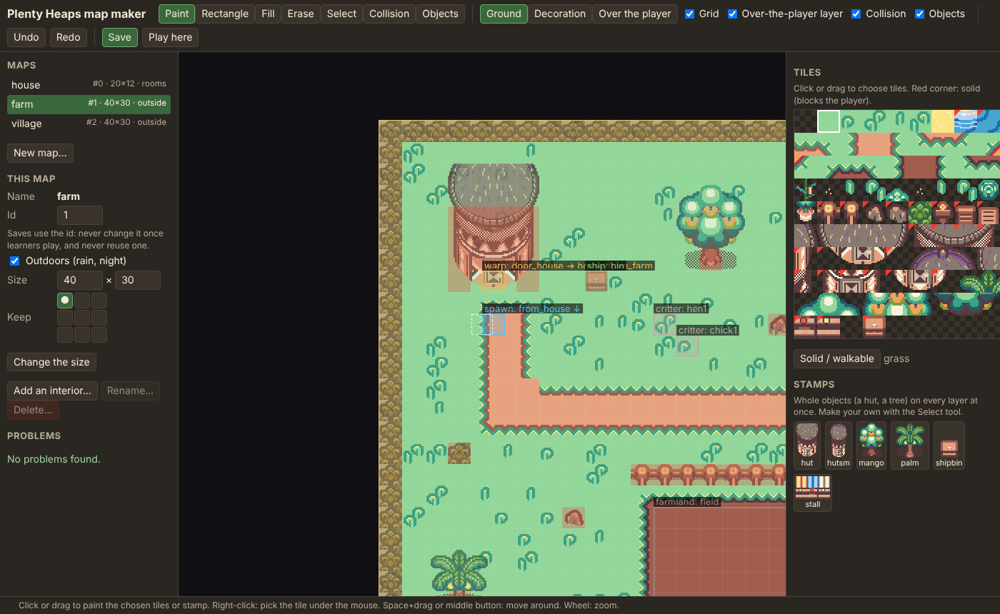

# The map maker

Plenty Heaps' maps are made with its own map maker. It runs on your computer and opens in your
browser: paint the ground, place buildings and trees, mark where the player can't walk, and link
maps together, including the rooms inside buildings. Then press **Play here** to walk around in it.



## Setting it up (once)

1. **Python 3.8 or later.** On Windows, get it from [python.org](https://www.python.org/downloads/) and tick
   **Add python.exe to PATH** in the installer. Nothing else is needed.
2. **A copy of the game.** The easiest way is [GitHub Desktop](https://desktop.github.com/): **File > Clone
   repository**, choose `togetherings/plenty-heaps`, and pick a folder.

## Opening it

In GitHub Desktop, choose **Repository > Open in Command Prompt** (or open a terminal in the game's
folder), and run:

```
python tools/map_maker.py
```

It opens `http://127.0.0.1:8300/` in your browser (Chrome, Edge or Firefox). Keep the window with the
command open while you work; close it (or press Ctrl+C) when you're done.

## Making changes

- **Maps** (left): click a map to open it. **New map…** makes an outdoor map. Each map has an **id**
  (0 to 63): saves use it to remember where the player is, so don't change it once learners play, and
  never give a removed map's id to a new one. **Outdoors** maps get rain and darker nights.
- **Size:** type the new width and height, choose which side stays put (the 3 × 3 buttons), and press
  **Change the size**. Everything on the map moves with the tiles. A map can be up to 255 × 255
  squares.
- **Layers** (top): **Ground** (grass, paths, water, floors), **Decoration** (things on the ground),
  and **Over the player** (roofs and tree tops, drawn over the player). Keys 1, 2, 3.
- **Tiles** (right): click a tile, or drag over several, then paint. A red corner means the tile is
  solid. **Solid / walkable** changes that for the chosen tiles on every map.
- **Stamps** (right): whole objects, like a hut or a mango tree, painted on all three layers at once.
  Make your own: **Select** a part of a map, then **Save as a stamp…**. Right-click a stamp to remove it.

### Tools

| Tool | Key | What it does |
|---|---|---|
| Paint | B | Click or drag to paint. Right-click picks up the tile under the mouse (Shift+right-click: from any layer). |
| Rectangle | R | Drag to fill a rectangle. |
| Fill | F | Fills the area of matching tiles (inside a room, only that room). |
| Erase | E | Clears tiles on the layer you're painting. |
| Select | S | Drag to select. Ctrl+C copies every layer, Ctrl+V pastes, Delete clears the layer (Shift+Delete: all of them). |
| Collision | C | Red squares block the player. Click to block a square by hand, right-click (or Shift) to open it whatever is there, Alt+click to undo either. |
| Objects | O | Click an object to change it, drag to move it, drag its corner to resize. Click an empty square to add one. |

Move around with Space+drag or the middle mouse button; zoom with the mouse wheel (or + and −).
Ctrl+Z and Ctrl+Y undo and redo, and Ctrl+S saves. The bottom line says which square the mouse is on
and what's there.

### Objects

| Object | What it is |
|---|---|
| spawn | A place the player arrives, facing a direction. |
| warp | Walking into it takes the player to another map: choose the map in **Goes to** and the spawn in **Arrive at**. **Add the way back** adds a spawn next to it and a warp back next to where it arrives. |
| room | One room of an interiors map (below). |
| farmland | The field that can be farmed (one, on the farm). |
| ship | The shipping crate. |
| bed | Sleep here to end the day. |
| sign | Shows words: the key of its text in `src/data/strings.js`. |
| critter | A hen, chick or crab that wanders around. |
| npc | A villager (for later). |

### Buildings and their rooms

Each part of the world is two maps at most: the outside, and one **interiors** map that holds the
rooms of all its buildings, side by side. The game only ever shows the room the player is in.

To add a room for a building: on the outside map, click the building's door square, then press
**Add an interior…**. Choose the interiors map (or a new one), a name and a size. The map maker makes
the room with walls, a floor and a doorway, and links the door both ways. Then paint the room as you
like. Rooms mustn't overlap; keep a gap between them.

## Saving and checking

**Save** (Ctrl+S) writes the maps into `maps-src/` and rebuilds `src/data/maps.js`, which the game
loads. The map maker then checks the maps. **Problems** (left) lists anything that would break the
game: a warp that leads nowhere, a spawn inside a wall, two maps with the same id. Click a problem to
go to it. It saves anyway, so you never lose work, but fix the problems before sharing the maps.

**Play here** saves, then opens the game in a new tab, standing on the square you last clicked, with a
ready-made character. Nothing is saved in that tab, so it never changes a real farm.

## Sharing your maps

In GitHub Desktop, your changed maps show up as changed files (`maps-src/…`, `src/data/maps.js`).
Make a branch, commit them with a short note ("Add the beach"), and publish it to make a pull request.
The game's checks run on it, including the map checks, and you merge it when **Checks passed** passes.

## Good to know

- The maps are in [Tiled](https://www.mapeditor.org/)'s format, so you can still open `maps-src/*.tmj`
  in Tiled. Save from the map maker afterwards so `src/data/maps.js` is rebuilt (or run
  `python tools/map_maker.py --build`).
- The map maker can only use tiles that are already in `assets/tiles.png`. New tiles come from the art
  packs with `tools/build_assets.py`, which needs the packs on your computer.
- The farm, the house and their names are used by the game's code, so they can't be renamed or deleted.
- More than about 250 objects on one map can be slow on old phones; the map maker says so.
